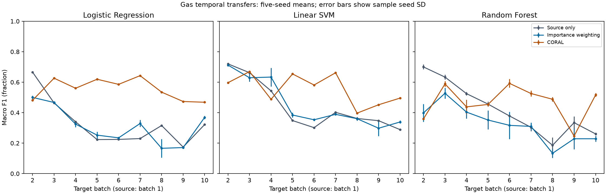
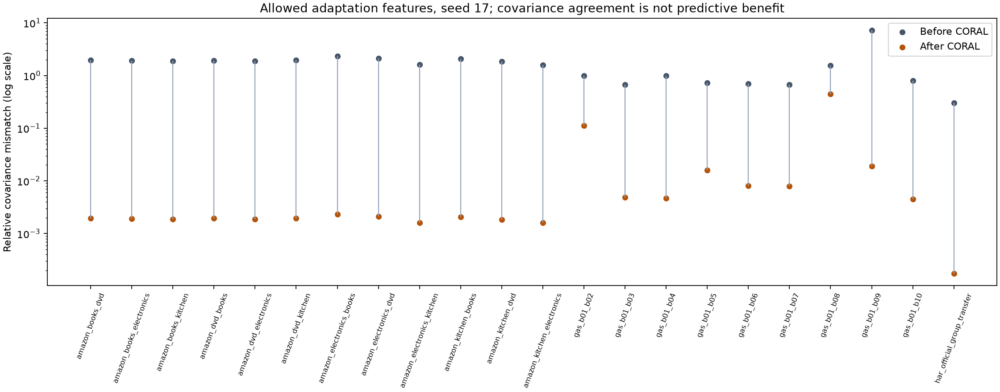

# Evaluating Domain Adaptation Techniques for Classical Machine Learning Models

Research report for Domain Shift Workbench

The completed study found that adaptation was useful in some transfers and
harmful in many others. Of 132 primary task-model-adaptation comparisons, mean
macro F1 increased in 40 and decreased in 92. CORAL helped gas classification
more consistently than it helped HAR or Amazon sentiment. These results support
conditional use of adaptation, with a matched source-only baseline and visible
failure diagnostics. They do not establish a universally superior method.

This report covers the frozen protocol, implementation, all completed comparisons,
their limitations and reproducibility. Student registration, institution,
supervisor and approval details were not supplied and are omitted. The separate
assistance disclosure describes the implementation support actually used.

## Abstract

Distribution shift can reduce the reliability of classical classifiers. This study evaluates domain-classifier importance weighting and centred, regularised CORAL against source-only Logistic Regression, linear Support Vector Machine and Random Forest models. Experiments use UCI Gas Sensor Array Drift, smartphone Human Activity Recognition and the original four-domain Amazon sentiment corpus, covering 22 transfers and five seeds. Source-only validation selects shared hyperparameters; separate target adaptation features support adaptation, while held-out target observations remain excluded until evaluation. The completed study contains 1,100 primary and 180 sensitivity evaluations. Across 132 primary adaptation comparisons, mean macro F1 improves in 40 and declines in 92; 27 descriptive group-bootstrap intervals include zero. CORAL benefits several gas transfers but adaptation generally harms HAR and Amazon performance. Accuracy, runtime, weight concentration and covariance diagnostics contextualise these outcomes. Shared test observations and few independent domains limit inference. The contribution is reproducible comparative evidence and an independently auditable local research workbench.

## 1 Introduction and objective

A classifier can encounter different input distributions after deployment. Gas
sensors change across acquisition periods, human activity features vary between
people, and expressions of sentiment vary between product categories. Here a
domain is a source or target setting within one dataset. No classifier combines
unrelated gas, activity and sentiment features into one training problem.

The exact assessment objective is:

To evaluate whether importance weighting and feature alignment using CORAL improve the performance of Logistic Regression, Support Vector Machine, and Random Forest when source and target data follow different distributions. The study will compare these techniques against models trained without adaptation across three public datasets, using accuracy, macro F1 score, and computational time. It will identify the conditions under which adaptation improves performance, provides little benefit, or reduces prediction quality.

Three research questions organize the analysis. First, how do importance
weighting and CORAL change target macro F1, accuracy and computational time against
the matched source-only model? Second, how do effects differ across temporal gas
transfers, disjoint HAR participants and Amazon categories? Third, what do weight
concentration and covariance diagnostics reveal about useful, uncertain and
harmful adaptation? The contribution is a reproducible empirical study and an
inspectable application. The methods themselves are established work.

## 2 Related work

Covariate-shift weighting assumes that input frequencies change while the
conditional label relationship remains suitable for transfer. Sugiyama et al.
develop importance-weighted validation [R02]; Huang et al. estimate weights by
kernel mean matching [R03]. Bickel et al. show how discrimination between training
and test inputs relates to density ratios [R11]. This project implements a
two-stage domain-classifier weighting procedure. It does not implement IWCV,
kernel mean matching or an integrated discriminative optimizer.

CORAL matches second-order statistics [R01]. Fernando et al. instead align
eigenvector subspaces [R06]. Matching a covariance matrix is different from
matching class-conditional distributions. Theoretical domain-adaptation bounds
include the feasibility of predicting well in both domains [R04], helping explain
why small marginal discrepancy alone is insufficient. Pan and Yang provide the
terminology and discuss negative transfer [R07].

The Amazon corpus and structural correspondence learning were introduced in the
sentiment study of Blitzer et al. [R05]. Vergara et al. motivate the gas-drift
setting with supervised temporal ensembles [R08]. Anguita et al. document the
HAR representation and overlapping windows [R09]. Those published protocols
differ from this one, so their scores are not treated as direct baselines. The
scikit-learn paper [R10] supplies the software citation; official version-matched
documentation [S01-S06] supports the actual interfaces. The companion literature
matrix compares eleven papers and records restricted full-text access explicitly.

## 3 Data and frozen partitions

The original archives were acquired on 10 October 2026. Parser version 2.0.0
retained the published numerical feature dimensions. Numerical inputs must be
finite; unexpected missing values fail validation rather than triggering
unreported imputation. Exact feature values, not rounded features, define
numerical duplicate groups. All archive hashes, acquisition timestamps, class
maps, exclusions and source label counts are recorded in the completed data cards.

| Dataset | Parsed | Retained | Excluded | Fields | Tasks |
| --- | --- | --- | --- | --- | --- |
| gas | 13910 | 13910 | 0 | 128 | 9 |
| har | 10299 | 10299 | 0 | 561 | 1 |
| amazon | 78679 | 70509 | 8170 | 1 | 12 |

Gas uses Batch 1 as the source for nine later batches. A fixed duplicate-safe
partition divides each target batch approximately in half without consulting its
labels. Batch 4 has 80 adaptation and 81 evaluation examples; this is a within-batch
holdout, not fine-grained chronological forecasting. All 13,910 observations were
retained. Gas uses 128 features and six canonical classes [D01].

HAR uses 7,352 windows from 21 official training participants as source. Target
adaptation contains 1,201 windows from participants 2, 4, 9 and 10; evaluation
contains 1,746 windows from participants 12, 13, 18, 20 and 24. All 10,299 windows
were retained. Source validation and the target roles keep whole people separate.
The test concerns adaptation to a population of different people, not calibration
to the same individual. The 561 features and six activities are the official
representation [D02].

Amazon uses books, DVDs, electronics and kitchen as four domains within one
dataset. All twelve ordered source-target pairs are evaluated. Of 78,679 parsed
records, 8,170 duplicate bodies were excluded and 70,509 remained. Retained labeled
counts are 1,956 books, 1,954 DVDs, 1,965 electronics and 1,977 kitchen reviews.
The corresponding unlabeled pools contain 5,473, 29,281, 12,405 and 15,498 bodies.
One additional source-target duplicate is excluded from DVD adaptation in the
books-to-DVD transfer. The separate original books unlabeled file was included.
Only review bodies enter features; ratings, file-label fields, titles and reviewer
metadata do not. Product identifiers are retained separately for grouping [D03].

Split seed 2026 fixes every role ID before model fitting. The same evaluation rows
are used for all methods and five model seeds. The complete 22-task count table
and split hashes accompany this report. No raw archive is included in the source
package: the gas landing page has both research-only wording and a CC BY 4.0
section; HAR states CC BY 4.0; the Amazon page has no explicit redistribution
license. Acquisition instructions and citations are provided instead.

## 4 Methods and fair comparison

Logistic Regression (LR), LinearSVC and Random Forest (RF) are fitted separately
on each dataset. The source-only model receives source features and labels. The
source-majority baseline always predicts the most frequent source class, with
deterministic tie breaking. Source-selected estimator parameters are shared
between source-only, importance weighting and CORAL within each paired comparison.

### Common representation and source selection

Gas and HAR use source-fitted standard scaling. Amazon uses lowercase unigram
and bigram TF-IDF with min_df 2, at most 20,000 features, sublinear term frequency
and no default stopword list. Source-fitted TruncatedSVD reduces this to at most
128 components below available rank, followed by source-fitted scaling. The same
dense representation is used by every primary method. Preprocessing is fitted
again inside each source validation fold, excluding that fold's validation rows.

Five-fold source macro F1 selects C from 0.1, 1 and 10 for LR and LinearSVC.
RF uses 200 trees and the four combinations of maximum depth unlimited or 20
and minimum leaf size 1 or 3. HAR folds preserve participant groups; Amazon uses
product groups when feasible. Thirty shared source searches produced 1,500
candidate-fold scores. Source-only selection keeps the comparison controlled,
but it need not choose the target-optimal model under distribution shift.

### Importance weighting

A separate logistic classifier predicts domain membership: source 0 or target
adaptation 1. It uses C 1, without class balancing or resampling. Five source
folds yield out-of-fold domain probabilities, training each discriminator on
the other source folds and all permitted target adaptation features. True target
task labels are not accepted by the training interface.

For a source observation, let q be the estimated target-domain probability,
ns the actual source count in its discriminator training fold, and nt the target
adaptation count. The implementation bounds q to [0.001, 0.999], calculates
`r = q / (1 - q) * ns / nt`, clips r to [0.05, 10], then divides by the global
mean of the clipped source weights. This prior correction removes the domain
sampling imbalance; final normalized weights need not remain within the raw
clipping interval. Each task estimator receives these weights through sample_weight.

Effective sample size is `ESS = sum(w)^2 / sum(w^2)`. ESS below 10% of the source
count produces a retained diagnostic warning. Weighting cannot create labeled
source support in a region absent from the source. Incorrect probabilities or a
changed conditional label relationship can make the weighting harmful. The
density-ratio motivation is related to R11; the fold and clipping choices are
the frozen implementation contract of this study.

### Centred regularised CORAL

For row-vector source and target-adaptation features, compute means ms and mt,
and unbiased covariances Cs0 and Ct0. Set `Cs = Cs0 + 0.001 I` and
`Ct = Ct0 + 0.001 I`. Symmetric eigendecomposition with eigenvalue floor 1e-8
gives `A = Cs^(-1/2) Ct^(1/2)`. Train on `(Xs - ms) A + mt` and source labels.
Predict target observations after the common source preprocessing; do not apply
the source alignment matrix to target inputs. This centred variant with mean
restoration is explicitly distinguished from the original CORAL presentation [R01].

The recorded mismatch is the Frobenius covariance difference divided by the target
covariance norm, floored at 1e-12 in the denominator. Ridge regularization means
the empirical covariances need not match exactly. Reduced mismatch is a geometric
diagnostic, not proof that the task decision boundary improved.

## 5 Implementation and validation

The Python package contains data contracts, parsers, preprocessing, source
selection, adaptation, fitting, evaluation and paired analysis. The CLI and
Streamlit workbench share the engine. Six pages expose actual saved evidence.
An explicit worker handles jobs, ownership, logs and cancellation; rerenders do
not train a model. The repository reader validates seals and file hashes. Each
displayed comparison links to run IDs, the frozen split and prediction checksums.

The data flow is: official archive to immutable parsed data to frozen split;
source folds to shared selection and preprocessing; source labels plus target
adaptation features to model fitting; completed-fit authorization to the evaluator;
saved predictions to metrics and group-bootstrap analysis; saved tables to UI
and exports. Held-out features and labels are excluded from fitting, including
domain discrimination, covariance estimation and tuning.

The tested machine has an Intel i7-14700HX, 16 GB RAM and RTX 4060 8 GB. Computation
uses one CPU job and one numerical thread; the GPU is unused. CPython 3.12.10,
NumPy 2.5.3, SciPy 1.18.1, pandas 2.3.3, scikit-learn 1.9.1 and Streamlit 1.65.0
are among 64 actual locked dependencies. The frozen scientific snapshot contains
38 files. Source, archive, split, configuration and dependency identities are
recorded before final evaluation.

Numerical and acceptance tests cover prior correction with unequal domain counts,
independent covariance checks, group separation, fold-only preprocessing,
held-out read refusal, sample-weight delivery, metric fixtures, mutation detection,
atomic artifacts and resume. The completed dashboard regression gate passed 212
tests, followed by 20 final interface checks; the current delivery audit adds
report/package checks. Six pages were exercised with real and empty storage;
16 actual Chrome screenshots cover desktop, tablet and detailed views. The
verification receipts distinguish automated checks from student understanding.

## 6 Evaluation and results

The completed primary matrix contains 990 classifier evaluations and 110 majority
evaluations. Predeclared sensitivity adds 180 evaluations, for 1,280 total. There
are no missing comparisons or classifier fitting failures. Seeds are 17, 29, 43,
71 and 101. Metrics are recomputed from persisted predictions rather than edited
summary values. Macro F1 averages classes present in the full held-out task, with
zero_division 0; absent classes are recorded. Accuracy, macro precision/recall,
per-class support and confusion matrices accompany it.

Each paired delta compares the same ordered evaluation IDs, seed, preprocessing
recipe, selected base parameters and dataset/split identities. The reported
uncertainty is a descriptive 95% paired percentile interval from 1,000 group
resamples with bootstrap seed 2026. Each resample averages the five fitted-seed
deltas without refitting. Gas uses duplicate-safe measurement groups, HAR whole
evaluation participants, and Amazon product groups where available. The intervals
are conditional on the fitted models and observed domains and are unadjusted for
multiple comparisons. Five seeds are not independent datasets.

### Dataset summaries

The following table uses equal task weights within each dataset, after averaging
the five seeds for each task. Scores are fractions and time is seconds. These
dataset averages do not pool unrelated observations or create an independent
sample size. Per-task mean/SD, paired intervals and exact run IDs remain in the
accompanying full tables.

#### GAS

| Model | Method | Accuracy | Macro F1 | Pipeline s | F1 delta pp |
| --- | --- | --- | --- | --- | --- |
| Linear SVM | CORAL | 0.596098 | 0.555106 | 0.123 | +11.348 |
| Linear SVM | Weighting | 0.478365 | 0.455392 | 0.454 | +1.376 |
| Linear SVM | Source | 0.463566 | 0.441627 | 0.094 | - |
| LR | CORAL | 0.610142 | 0.554631 | 0.250 | +22.576 |
| LR | Weighting | 0.458709 | 0.312692 | 0.185 | -1.617 |
| LR | Source | 0.450858 | 0.328867 | 0.080 | - |
| Majority | Source | 0.199823 | 0.058899 | 0.037 | - |
| RF | CORAL | 0.564881 | 0.467566 | 0.563 | +4.791 |
| RF | Weighting | 0.426469 | 0.322044 | 0.498 | -9.761 |
| RF | Source | 0.480556 | 0.419659 | 0.462 | - |

#### HAR

| Model | Method | Accuracy | Macro F1 | Pipeline s | F1 delta pp |
| --- | --- | --- | --- | --- | --- |
| Linear SVM | CORAL | 0.933562 | 0.932259 | 6.752 | -5.235 |
| Linear SVM | Weighting | 0.975372 | 0.975521 | 34.704 | -0.909 |
| Linear SVM | Source | 0.984536 | 0.984613 | 7.403 | - |
| LR | CORAL | 0.942153 | 0.939980 | 5.754 | -2.965 |
| LR | Weighting | 0.967354 | 0.966716 | 11.639 | -0.291 |
| LR | Source | 0.970790 | 0.969630 | 4.639 | - |
| Majority | Source | 0.187285 | 0.052581 | 2.355 | - |
| RF | CORAL | 0.935510 | 0.928315 | 30.938 | -1.285 |
| RF | Weighting | 0.936770 | 0.930070 | 22.753 | -1.109 |
| RF | Source | 0.946850 | 0.941164 | 27.042 | - |

#### AMAZON

| Model | Method | Accuracy | Macro F1 | Pipeline s | F1 delta pp |
| --- | --- | --- | --- | --- | --- |
| Linear SVM | CORAL | 0.693304 | 0.689062 | 10.719 | -4.382 |
| Linear SVM | Weighting | 0.707230 | 0.706099 | 11.166 | -2.678 |
| Linear SVM | Source | 0.733862 | 0.732884 | 6.134 | - |
| LR | CORAL | 0.699145 | 0.694939 | 10.695 | -3.883 |
| LR | Weighting | 0.707991 | 0.706888 | 11.132 | -2.688 |
| LR | Source | 0.734645 | 0.733769 | 6.117 | - |
| Majority | Source | 0.505741 | 0.335873 | 6.127 | - |
| RF | CORAL | 0.694431 | 0.690214 | 14.369 | +0.128 |
| RF | Weighting | 0.659609 | 0.646201 | 12.774 | -4.273 |
| RF | Source | 0.691885 | 0.688930 | 9.668 | - |

CORAL's average gas gains are concentrated in LR and linear SVM; the method is
not beneficial for every gas transfer. The HAR source-only models already perform
strongly, and all six primary adaptation comparisons have lower mean macro F1.
For Amazon, both adaptations usually reduce the linear models' macro F1. RF with
CORAL has a small positive average across Amazon tasks despite mixed task effects.
An average should therefore be read alongside the direction counts and task plots.

| Dataset | Method | Pairs | Positive | Negative | CI includes 0 |
| --- | --- | --- | --- | --- | --- |
| amazon | CORAL | 36 | 8 | 28 | 7 |
| amazon | Weighting | 36 | 3 | 33 | 4 |
| gas | CORAL | 27 | 19 | 8 | 5 |
| gas | Weighting | 27 | 10 | 17 | 9 |
| har | CORAL | 3 | 0 | 3 | 1 |
| har | Weighting | 3 | 0 | 3 | 1 |

Across all 132 primary comparisons, 40 means increase, 92 decrease and none are
exactly unchanged. Twenty-seven macro-F1 intervals include zero. An interval
including zero is uncertainty, not proof that two methods are equivalent.

Figure 1. Gas Batch 1 to Batches 2-10, primary macro F1 in fractions, five-seed
means with error bars showing sample seed SD. Batch identities
and each trace's exact run IDs are in the original figure-trace manifest. Tasks
share a source and are not independent replications.

### Positive uncertain and negative examples

| Example | Transfer | Model | Method | Delta pp | 95% interval pp |
| --- | --- | --- | --- | --- | --- |
| positive | Gas 1→07 | LR | CORAL | +41.284465 | [+38.973957, +43.482547] |
| uncertain | Gas 1→08 | Linear SVM | Weighting | -0.148662 | [-1.266615, +0.828300] |
| negative | Gas 1→02 | RF | CORAL | -34.075518 | [-36.618668, -18.709011] |

The positive example is CORAL with LR on gas Batch 7: mean improvement is
41.284465 percentage points. On gas Batch 8, importance weighting with linear SVM
changes macro F1 by -0.148662 points, with an interval spanning zero. On gas Batch
2, CORAL with RF reduces macro F1 by 34.075518 points. These are descriptive
examples selected for interpretation after the complete analysis; they did not
select a new primary setting. The full task tables retain the other comparisons.

### Variation and computational cost

#### gas_b01_b10

| Model | Method | Accuracy mean ± SD | Macro F1 mean ± SD | Pipeline s |
| --- | --- | --- | --- | --- |
| Linear SVM | CORAL | 0.533333 ± 0.000000 | 0.495735 ± 0.000000 | 0.118 |
| Linear SVM | Weighting | 0.397333 ± 0.010149 | 0.338931 ± 0.010036 | 0.290 |
| Linear SVM | Source | 0.348333 ± 0.000000 | 0.288451 ± 0.000000 | 0.100 |
| LR | CORAL | 0.500556 ± 0.000000 | 0.468356 ± 0.000000 | 0.172 |
| LR | Weighting | 0.423111 ± 0.012175 | 0.369173 ± 0.010679 | 0.202 |
| LR | Source | 0.369444 ± 0.000000 | 0.321932 ± 0.000000 | 0.079 |
| Majority | Source | 0.172778 ± 0.000000 | 0.049108 ± 0.000000 | 0.042 |
| RF | CORAL | 0.568444 ± 0.011093 | 0.516200 ± 0.012263 | 0.595 |
| RF | Weighting | 0.313222 ± 0.012487 | 0.228830 ± 0.019438 | 0.535 |
| RF | Source | 0.333889 ± 0.007233 | 0.260502 ± 0.008091 | 0.483 |

#### har_official_group_transfer

| Model | Method | Accuracy mean ± SD | Macro F1 mean ± SD | Pipeline s |
| --- | --- | --- | --- | --- |
| Linear SVM | CORAL | 0.933562 ± 0.000000 | 0.932259 ± 0.000000 | 6.752 |
| Linear SVM | Weighting | 0.975372 ± 0.000000 | 0.975521 ± 0.000000 | 34.704 |
| Linear SVM | Source | 0.984536 ± 0.000000 | 0.984613 ± 0.000000 | 7.403 |
| LR | CORAL | 0.942153 ± 0.000000 | 0.939980 ± 0.000000 | 5.754 |
| LR | Weighting | 0.967354 ± 0.000000 | 0.966716 ± 0.000000 | 11.639 |
| LR | Source | 0.970790 ± 0.000000 | 0.969630 ± 0.000000 | 4.639 |
| Majority | Source | 0.187285 ± 0.000000 | 0.052581 ± 0.000000 | 2.355 |
| RF | CORAL | 0.935510 ± 0.002483 | 0.928315 ± 0.002614 | 30.938 |
| RF | Weighting | 0.936770 ± 0.001188 | 0.930070 ± 0.001163 | 22.753 |
| RF | Source | 0.946850 ± 0.001689 | 0.941164 ± 0.001827 | 27.042 |

#### amazon_books_electronics

| Model | Method | Accuracy mean ± SD | Macro F1 mean ± SD | Pipeline s |
| --- | --- | --- | --- | --- |
| Linear SVM | CORAL | 0.657608 ± 0.006521 | 0.655290 ± 0.006620 | 7.613 |
| Linear SVM | Weighting | 0.665344 ± 0.006983 | 0.663719 ± 0.006617 | 7.848 |
| Linear SVM | Source | 0.704733 ± 0.003325 | 0.701793 ± 0.003351 | 6.068 |
| LR | CORAL | 0.664122 ± 0.006075 | 0.661715 ± 0.006342 | 7.584 |
| LR | Weighting | 0.664733 ± 0.006822 | 0.662942 ± 0.006390 | 7.837 |
| LR | Source | 0.705547 ± 0.005147 | 0.702958 ± 0.005129 | 6.063 |
| Majority | Source | 0.502290 ± 0.000000 | 0.334350 ± 0.000000 | 6.075 |
| RF | CORAL | 0.673893 ± 0.003440 | 0.670395 ± 0.003180 | 9.710 |
| RF | Weighting | 0.627684 ± 0.016657 | 0.624856 ± 0.019394 | 8.651 |
| RF | Source | 0.656896 ± 0.006164 | 0.655878 ± 0.006095 | 8.241 |

Table values above are saved five-seed means with sample SD, with primary settings
only. A displayed SD of 0.000000 can represent deterministic predictions or
floating-point rounding near zero; it does not remove test-sample uncertainty.
Pipeline time sums original preprocessing fit, adaptation fit, classifier fit
and target prediction time. Shared source tuning is reported separately, and
the originating component time is retained for cached runs. Summing every row
would double-count shared computation.

| Dataset | Preprocess s | CV s | 10 fits s | Wall s | Peak MiB |
| --- | --- | --- | --- | --- | --- |
| gas | 0.017 | 20.403 | 1.575 | 25.361 | 284.2 |
| har | 3.497 | 749.701 | 145.266 | 943.342 | 687.0 |
| amazon | 3.845 | 50.542 | 4.957 | 68.054 | 517.0 |

The representative gas, HAR and Amazon benchmarks measured complete source search
and ten primary fits at seed 17. Peak RAM is process-lifetime working set,
including imports and persistence. Their study-wide planning projection was
2.98-3.97 hours from scratch, including stated allowance for unmeasured work.
This is an estimate, not observed total elapsed completion time. The successful
resumed invocation lasted 2,162.844113 seconds and the first completed fitting
boundary recorded 7,629.014105 seconds; these scopes overlap and must not be added.
Two Windows progress-file replacement interruptions were retained and resumed.
They were operational failures, while classifier fitting failures were zero.

### Diagnostics and sensitivity

The saved diagnostics retain 180 low-ESS warnings across the completed fit records.
These are not 180 independent failures: transformations are shared across models.
Concentrated weights indicate limited effective source support, but cannot alone
identify the causal reason for negative transfer. CORAL can greatly reduce the
covariance residual while worsening macro F1, as seen in the saved gas comparison.

Figure 2. Saved CORAL covariance residuals before and after alignment for the
declared diagnostic tasks. Residuals are normalized Frobenius quantities, not
classification scores; the plotted positive values use a logarithmic display.
The figure manifest links their exact input diagnostics and run IDs.

Clipping bounds 5, 10 and 20 and ridge values 0.0001, 0.001 and 0.01 were evaluated
on gas Batch 10, HAR and books-to-electronics with all five seeds and three models.
For gas linear SVM, increasing clipping from 5 to 20 changes mean macro F1 from
0.319973 to 0.354481, while the primary value 10 gives 0.338931. For HAR RF the
corresponding values fall from 0.934667 to 0.923518. These different responses
argue against choosing one new clipping bound from held-out performance.

For gas LR, ridge 0.0001, 0.001 and 0.01 gives mean macro F1 0.441869, 0.468356
and 0.494883. For books-to-electronics LR it gives 0.661510, 0.661715 and
0.663333. All declared settings, SDs, deltas and run IDs remain available in the
sensitivity tables. The primary ridge stays 0.001 and primary clipping stays 10.

## 7 Discussion and limitations

The first research question has a conditional answer: both gains and losses
occur, and method choice depends on the dataset, classifier and transfer. The
second question shows a clear contrast in this study between several useful gas
alignments and mostly negative HAR/Amazon adaptation. For the third, ESS and
covariance diagnostics make the behavior inspectable but do not prove mechanisms.
Strong source performance can leave little room for improvement, and an
unsupervised marginal adjustment may move useful class structure in the wrong
direction. These are plausible interpretations, not a causal identification.

Source-only hyperparameter selection was fixed for fairness and may disadvantage
a method that would benefit from a different target-aware selection criterion.
The density-ratio model can be misspecified, and covariate-shift support and
conditional-label assumptions are not established by these experiments. CORAL
only uses first/second-order information in the specified dense representation.
The 128-component text representation limits vocabulary directions available
to all methods, including source-only.

Only three independent applications are included. Amazon tasks reuse categories
and reviews, gas transfers share Batch 1, and HAR has five evaluation people.
Group bootstrap reduces some dependence but does not make these populations
independent or representative of all future deployments. Finer gas timestamps
are unavailable for a complete within-batch dependence model. Target-present
class sets differ between some gas batches. Unadjusted intervals and repeated
seeds must not be converted into a universal significance claim.

The runtime projection is specific to the tested CPU and thread settings.
Reproduction on the same laptop checks installation and deterministic behavior,
not portability to every OS or hardware stack. Interface keyboard tests cover
the recorded paths and do not certify screen-reader accessibility. Institutional
formatting and student rehearsal remain human submission responsibilities.

## 8 Reproduction and conclusion

A clean checkout and fresh virtual environment reproduced gas Batch 1 to Batch 2 using all five seeds and 50 newly fitted models/baselines. All 50 ordered prediction vectors, metric dictionaries and selected parameters exactly matched the original study on 622 evaluation rows per run. Fitting took 204.295694 seconds; fitting, evaluation and comparison took 245.421423 seconds. Peak process working set was 216.0625 MiB. No forbidden held-out training reads occurred. The original archive/split were verified and reused; new caches/models/predictions were written separately. The detailed reproduction record preserves the exact executed driver and logs.

The reproducibility guide gives exact environment, acquisition, execution,
checkpoint/resume and export commands. The package includes permitted code,
configuration, aggregate results, screenshots and hashes. Exact local sample IDs
and prediction files remain inspectable through the saved study; data acquisition
instructions replace redistribution of raw archives. The supplied original pack
MANIFEST.sha256 still describes its original files; new deliverables use a separate
manifest rather than rewriting that historical record.

The completed evidence answers the locked objective without assuming adaptation
must succeed. CORAL can improve classical models under some gas transfers, but
neither covariance alignment nor importance weighting is uniformly reliable across
these applications. A matched source-only baseline, negative-transfer analysis,
explicit data roles and reproducible evidence are central to interpreting an
adaptation result. Further work could study independent populations, target-data
budgets or justified model-selection strategies under a new protocol.

## Appendix A Original proposal abstract

The following planned-work abstract is preserved separately from the results
abstract above. It contains the original 150 words.

Machine learning models can perform well on training data but struggle when applied to data collected under different conditions. This project will investigate whether domain adaptation can reduce this performance gap for Logistic Regression, Support Vector Machine, and Random Forest classifiers. It will compare importance weighting and correlation alignment (CORAL) with models trained without adaptation. Experiments will use the Gas Sensor Array Drift dataset, Human Activity Recognition Using Smartphones dataset, and Amazon Multi-Domain Sentiment dataset. These datasets represent changes over time, between users, and across product categories. Adaptation will use labelled source data and unlabelled target data, while target labels will be reserved for final evaluation. Accuracy, macro F1 score, and computational time will be measured across repeated experiments. The study aims to identify when adaptation improves predictions, when it offers limited benefit, and when it reduces performance, helping explain which approaches are useful under different types of distribution shift.

## Appendix B Evidence and contribution record

The full per-task means/SD, paired seed changes, bootstrap intervals, per-run
timings and sensitivity outputs are in the source package under reports/study.
The companion completed data cards and split table record dataset provenance.
The interface review links real screenshots to current app source hashes.
The requirements checklist maps claims to executable checks and artifacts.

Codex provided substantial implementation, testing, execution, analysis tooling,
writing and document-review assistance. The student's request fixed scope and
selected the 150-word results abstract. No independent student implementation,
rehearsal, faculty approval or publication acceptance is inferred from Git author
metadata. The factual assistance record identifies what is observed and what
the student must independently review and be able to defend.

## References

Checked against the primary publisher, proceedings, author or official software
source on 11 October 2026. Method and dataset claims below are attributed to their
original sources. Project scores come from the saved local study, not these papers.

R01. Sun, B., Feng, J. and Saenko, K. (2016). Return of Frustratingly Easy Domain
Adaptation. Proceedings of AAAI, 30(1). DOI: 10.1609/aaai.v30i1.10306.
[Publisher and paper](https://ojs.aaai.org/index.php/AAAI/article/view/10306).

R02. Sugiyama, M., Krauledat, M. and Müller, K.-R. (2007). Covariate Shift
Adaptation by Importance Weighted Cross Validation. JMLR, 8, 985-1005.
[Paper](https://www.jmlr.org/papers/v8/sugiyama07a.html).

R03. Huang, J., Smola, A. J., Gretton, A., Borgwardt, K. M. and Schölkopf, B.
(2007). Correcting Sample Selection Bias by Unlabeled Data. Advances in Neural
Information Processing Systems 19, proceedings of NIPS 2006.
[Paper](https://proceedings.neurips.cc/paper_files/paper/2006/file/a2186aa7c086b46ad4e8bf81e2a3a19b-Paper.pdf).
Author order follows the paper PDF; the online proceedings metadata orders authors differently.

R04. Ben-David, S., Blitzer, J., Crammer, K., Kulesza, A., Pereira, F. and
Vaughan, J. W. (2010). A theory of learning from different domains. Machine
Learning, 79, 151-175. DOI: 10.1007/s10994-009-5152-4.
[Article](https://link.springer.com/article/10.1007/s10994-009-5152-4).
Online publication was in 2009; the cited journal volume is 2010.

R05. Blitzer, J., Dredze, M. and Pereira, F. (2007). Biographies, Bollywood,
Boom-boxes and Blenders: Domain Adaptation for Sentiment Classification.
Proceedings of ACL, 440-447.
[Paper](https://aclanthology.org/P07-1056/).

R06. Fernando, B., Habrard, A., Sebban, M. and Tuytelaars, T. (2013).
Unsupervised Visual Domain Adaptation Using Subspace Alignment. ICCV, 2960-2967.
[Proceedings](https://openaccess.thecvf.com/content_iccv_2013/html/Fernando_Unsupervised_Visual_Domain_2013_ICCV_paper.html).

R07. Pan, S. J. and Yang, Q. (2010). A Survey on Transfer Learning. IEEE
Transactions on Knowledge and Data Engineering, 22(10), 1345-1359.
DOI: 10.1109/TKDE.2009.191.
[Publisher](https://ieeexplore.ieee.org/document/5288526);
[author manuscript](https://www.cse.ust.hk/~qyang/Docs/2009/tkde_transfer_learning.pdf).

R08. Vergara, A., Vembu, S., Ayhan, T., Ryan, M. A., Homer, M. L. and
Huerta, R. (2012). Chemical gas sensor drift compensation using classifier
ensembles. Sensors and Actuators B: Chemical, 166-167, 320-329.
DOI: 10.1016/j.snb.2012.01.074.
[Publisher](https://www.sciencedirect.com/science/article/pii/S0925400512002018).

R09. Anguita, D., Ghio, A., Oneto, L., Parra, X. and Reyes-Ortiz, J. L. (2013).
A Public Domain Dataset for Human Activity Recognition Using Smartphones.
ESANN, 437-442.
[Proceedings paper](https://www.esann.org/sites/default/files/proceedings/legacy/es2013-84.pdf).

R10. Pedregosa, F. et al. (2011). Scikit-learn: Machine Learning in Python.
JMLR, 12, 2825-2830.
[Paper](https://www.jmlr.org/papers/v12/pedregosa11a.html).

R11. Bickel, S., Brückner, M. and Scheffer, T. (2009). Discriminative Learning
Under Covariate Shift. JMLR, 10, 2137-2155.
[Paper](https://www.jmlr.org/papers/v10/bickel09a.html).

D01. Vergara, A. (2012). Gas Sensor Array Drift Dataset. UCI Machine Learning
Repository, dataset 224. DOI: 10.24432/C5RP6W.
[Dataset](https://archive.ics.uci.edu/dataset/224/gas+sensor+array+drift+dataset).

D02. Reyes-Ortiz, J., Anguita, D., Ghio, A., Oneto, L. and Parra, X. (2013).
Human Activity Recognition Using Smartphones. UCI Machine Learning Repository,
dataset 240. DOI: 10.24432/C54S4K.
[Dataset](https://archive.ics.uci.edu/dataset/240/human+activity+recognition+using+smartphones).

D03. Dredze, M. Multi-Domain Sentiment Dataset, original four-domain release.
Author-hosted distribution, page last updated 2 August 2007; cite R05.
[Dataset and separate books file](https://www.cs.jhu.edu/~mdredze/datasets/sentiment/index2.html).

S01. Scikit-learn developers. LogisticRegression, version 1.9.1 documentation.
[API](https://scikit-learn.org/stable/modules/generated/sklearn.linear_model.LogisticRegression.html).

S02. Scikit-learn developers. LinearSVC, version 1.9.1 documentation.
[API](https://scikit-learn.org/stable/modules/generated/sklearn.svm.LinearSVC.html).

S03. Scikit-learn developers. RandomForestClassifier, version 1.9.1 documentation.
[API](https://scikit-learn.org/stable/modules/generated/sklearn.ensemble.RandomForestClassifier.html).

S04. Scikit-learn developers. StratifiedGroupKFold, version 1.9.1 documentation.
[API](https://scikit-learn.org/stable/modules/generated/sklearn.model_selection.StratifiedGroupKFold.html).

S05. Scikit-learn developers. TfidfVectorizer, version 1.9.1 documentation.
[API](https://scikit-learn.org/stable/modules/generated/sklearn.feature_extraction.text.TfidfVectorizer.html).

S06. Scikit-learn developers. TruncatedSVD, version 1.9.1 documentation.
[API](https://scikit-learn.org/stable/modules/generated/sklearn.decomposition.TruncatedSVD.html).

## Verification scope

R01-R05, R07, R09-R11 were checked using primary full-paper text, including the
method or dataset sections used here. R06 was checked using the indexed CVF
proceedings abstract and metadata; direct HTML/PDF access returned HTTP 403.
R08 was checked using the indexed publisher abstract, introduction and method
preview; direct publisher access also returned HTTP 403. No unseen experimental
detail from either restricted paper is claimed. IEEE's page required JavaScript;
the author-hosted R07 manuscript supplied the text. The DOI, volume and page
metadata identify the final publication separately from that manuscript.

D01-D03 and S01-S06 were opened directly. The online scikit-learn documentation
identified itself as 1.9.1, matching the installed scientific environment.
The reading matrix records limitations and relevance; it does not claim that
the student independently read or verified every source.

